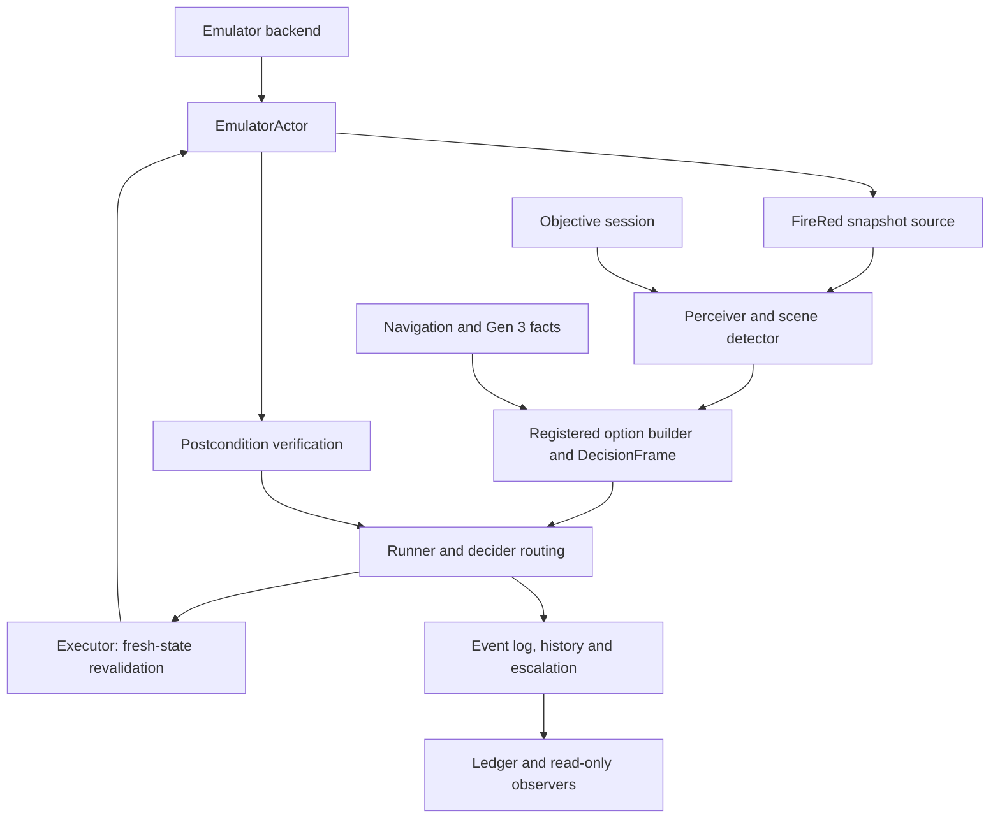

# Current architecture baseline (R01)

**Status:** initial static audit, not a full line-by-line review. **Baseline:** [`c73774285e5e164d01629ca14a5e8e551e03493f`](https://github.com/aimd-labs/pokegent/commit/c73774285e5e164d01629ca14a5e8e551e03493f), 2026-11-22; inspected 2026-11-24. All repository paths below refer to this baseline. This is descriptive, not an approved target architecture or a replacement for [runtime contracts](../contracts.md).

## 1. Inventory and verification boundary

The recursive Git tree was returned without truncation: 485 tracked file entries, including 110 files named `test_*.py` (not a test-case count). Selected source modules and documentation were read directly; other modules are inventoried by path and size. No local runtime or ROM tests were executed by this audit. The baseline's [public CI run](https://github.com/aimd-labs/pokegent/actions/runs/45069405352) completed successfully in all three jobs: `public-checks`, `native-helper`, `public-startup-latency`. This is historical evidence for the public checks, not full gameplay verification. The native helper job uses synthetic tests, not a native gameplay run.

| Area | Tracked files | Responsibility |
|---|---:|---|
| `pokegent/` root | 28 | Composition, CLI, runner, actor, server, events, history, recovery, operations, ledger |
| `pokegent/actions/` | 117 | Scene families, option builders, macros, verifiers, scene ownership |
| `pokegent/games/` | 93 | FireRed reader/maps/ROM and Gen 3 shared mechanics, move rules and damage |
| `pokegent/goals/` | 13 | Objective model, storage, validation, progression, dex/story fallback |
| `pokegent/navigation/` | 11 | World graph, planner, route adapter, requirements, serving |
| `pokegent/options/` | 6 | Immutable choices, criteria rendering, registries, ranking |
| `pokegent/state/` | 7 | Scene detection/catalog, briefing, state presentation |
| `pokegent/memory/` | 2 | Memory reader |
| `pokegent/references/` | 3 | ROM profiles, scene vocabulary, item classes |
| `pokegent/dashboard/` | 18 | Separate dashboard and picture/audio stream surfaces |
| `pokegent/testing/` | 2 | Fake emulator infrastructure |
| `addons/` | 15 | Add-on wiring, System One provider/transport/hybrid policy |
| `tests/` | 113 | Synthetic RAM, runtime, provider, navigation, packaging, operations and data checks |
| `docs/` | 17 | Runtime and operational contracts, configuration and local data schemas |
| `ops/` | 13 | Local owner, supervisor and ledger operations |
| `tools/` | 8 | Public startup, ROM-data guard, debugging and extraction tooling |
| `examples/`, `skill/`, `.github/`, root metadata | remainder | Agent example, agent skill, CI, contribution and provenance |

## 2. Runtime data and control flow

`app.py:build_runner` is the composition root; `loop.py:Runner` coordinates the flow; `pipeline.py:Perceiver` supplies immutable decision frames. `actions/_exec/executor.py:Executor` is the action authority. `emulator.py:EmulatorActor` is the single writer. Detectors must not press buttons. Deciders select offered IDs, not raw inputs. Execution revalidates the current scene, fingerprint and option before input, and verifies outcomes afterward. Unknown legality fails closed; unknown scenes may receive only a bounded conservative hybrid recovery window. See [CONTEXT](../../CONTEXT.md) and [contracts](../contracts.md).

### Existing seams, not yet a generic game plugin

| Layer | Evidence at baseline | Boundary assessment |
|---|---|---|
| Backend | `emulator.py`: `Emulator`, `PyBoyEmulator`, `PyGBAEmulator`, `create_emulator`, `EmulatorActor`, `ReadOnlyEmulatorView`, `EmuClock` | Backend abstraction exists; class presence does not establish game compatibility. `PyGBAEmulator` naming is historical; README describes native mGBA bindings. |
| Snapshot | `pipeline.py`: `SnapshotSource`, `IncrementalSnapshotSource`; `games/gen3/firered/reader/snapshot_sources.py` | Protocol currently references FireRed `StateSnapshot`. |
| Game composition | `app.py`: `build_runner`, `build_facts`, `make_objective_session` | Direct FireRed `RomProfile` and snapshot imports; no second game implementation demonstrated. |
| Rules | `games/gen3/ruleset/{damage,catch,effects}.py`, `games/gen3/mechanics/{facts,exchange,team_planning}.py` | Useful Gen 3 separation; no proof every rule is portable across Gen 3 titles or complete. |
| State/action | `actions/__init__.py`, `actions/ownership.py`, `options/models.py`, `actions/_exec/` | Registries, scene ownership and typed semantic options are valuable reusable contracts; concrete families still depend on game semantics. |
| Navigation | `navigation/{graph,adapter,planner}.py` | `graph.py` imports FireRed constants, map motion, script scanners and boulder logic; `adapter.py` imports FireRed capabilities and map helpers. Preserve graph/planner algorithms while separating title-specific construction. |
| Objectives | `goals/{models,source,tracker,store,story,dex_fallback}.py` | Revisioned goal lifecycle and verification are reusable; dex fallback imports FireRed wild data. Story data is local and conditional. |
| External control | `server.py`, `cli.py`, `examples/choose_inspected_frame.py`, [agent onboarding](../connect-your-agent.md) | Local HTTP inspect/choose/verify; exact frame binding. Do not expose arbitrary button actions or reintroduce removed mutable upstream endpoints. |
| Add-ons | `pokegent/addons.py`, `addons/runtime.py`, `addons/system_one/`, `dashboard/` | Three documented optional components (stream, dashboard, System One). Observer taps and decider wrapping exist; not evidence of a general third-party gameplay extension SDK. |
| Observability | `events.py`, `history.py`, `ledger*.py`, `review.py`, `supervisor.py`, `ops/` | Existing evidence infrastructure; extend rather than invent a parallel telemetry system. |

## 3. Game and mechanics coverage

Only FireRed USA Rev 0 is marked supported in `pokegent/references/rom_profiles.yaml`; Rev 1 is explicitly unsupported (no verified symbols). Other GBA titles, GB/GBC, DS, 3DS and Switch are not demonstrated. The README documents native Ubuntu 24.04 amd64 / Python 3.11 / mGBA 0.10.2 setup and reaching the first field with three RAM-verified movements. That is a narrow native smoke result. The public repository contains no full campaign evidence reviewed here; live progress reports are not automatically reproducible acceptance results.

Mechanics inventory is in [taxonomy](../capabilities/taxonomy.yaml) and [compatibility](../capabilities/compatibility.yaml). Existing `actions/coverage.py` marks five explicit `REAL_GAPS`: `field.fishing`, `field.hidden_item`, `field.ice_slide`, `field.sweet_scent`, `field.unknown_obstacle`. Its `NOT_NEEDED_FOR_E4` classification is a campaign-scoped reporting disposition, **not** a decision that these features are outside the core. Breeding, trading, Pokédex menus, move tutors and other ordinary mechanics remain in the core scope. Folded scenes likewise describe macro ownership, not verified full coverage. Retain the existing scene catalog and use `pokegent scenes` for detailed coverage when the checkout is runnable.

## 4. Decision modes and Hybrid

- **Agent:** `server.py` exposes local `/briefing`, `/frame`, `/choose`. Submission returns queued, not executed; stale frames are rejected. External waits can be indefinite by contract.
- **System One:** `addons/system_one/` provides custom HTTP and explicitly configured OpenAI-chat adapters, exact choice IDs, bounded transport and redacted telemetry. `docs/system-one.md` says no native Ollama protocol, automatic fallback provider or built-in model host. The optional provider should remain replaceable.
- **Hybrid:** `HybridDecider` supports low/missing-confidence handoff, route-step veto, irreversible-action escalation, repeated-option handling, and bounded unknown/no-progress recovery. Code has a default confidence threshold of 0.35 (scalar or per-scene mapping). The separate provider calibration policy is observe-first; do not conflate that with hybrid routing thresholds. OpenAI-chat has no calibrated confidence; default hybrid escalates its decisions, an important performance and liveness limitation.
- **Deterministic runtime:** only a forced singleton whose executor is deterministic, autoplay-safe or takes no input bypasses the model, and only in a known scene; every other action-bearing option goes to the decider, including in agent mode. All modes pass the same executor and guards. No action should require a model merely to complete deterministic mechanics. Strategic autonomy should still be evaluated independently in each mode.

Relevant tests by inventory: `test_hybrid_adaptive_gate.py`, `test_hybrid_agent_handoff_timeout.py`, `test_hybrid_irreversible_escalation.py`, `test_hybrid_route_step_veto.py`, `test_hybrid_stuck_escalation.py`, `test_system1_generic.py`, `test_system1_security.py`, `test_handoff_record.py`. These paths establish intended test coverage; this audit did not inspect every assertion or reproduce calibration results.

## 5. Maintenance and architectural risk

Existing OSS foundations: MIT license, upstream attribution, `source-lock.md`, `THIRD_PARTY_NOTICES.md`, contributor rules, security policy, code of conduct, issue/PR templates, read-only public CI with pinned actions, and [v0.1.0 release](https://github.com/aimd-labs/pokegent/releases/tag/v0.1.0). The public install is Python 3.11 only; `ruff` targets py310 (consistency review, not a functional defect). Existing issues cover security automation, ownership, release reproducibility and game-plugin design; use those rather than duplicate them.

Large coupled modules warrant measurement before decomposition: `actions/field/macros.py` (157,993 bytes), `navigation/graph.py` (148,377), `actions/field/builder.py` (127,642), `loop.py` (113,215), `navigation/adapter.py` (92,335), `app.py` (85,971), `emulator.py` (84,457). Size is a review signal, not evidence of incorrect behavior. The dependency direction (generic-named modules importing title-specific structures) is a stronger architectural signal. Avoid a big-bang rewrite; preserve frozen v1.x contracts and use characterization tests.

See [gap analysis](../research/gap-analysis.md) and [roadmap](../../ROADMAP.md) for proposed next steps. All references are at the pinned baseline; no runtime changes are proposed by this document.
